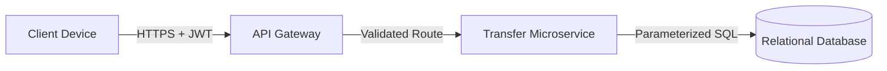

**Overview:** A structured threat model for a secure bank transfer module,
outlining the architectural data flow, trust perimeters, and specific
mitigations required to protect financial transactions against the STRIDE
threat categories.

**Exercise:**

> **Threat-model a bank transfer module**
> A logged-in user transfers money between accounts. Map the full data flow,
> identify the trust boundaries, then use STRIDE to find at least one threat
> per relevant category and propose a mitigation for each.

### 1. Data Flow Diagram

The architectural flow mandates a backend business logic layer (Microservice)
between the perimeter proxy and the storage layer.

### 2. Trust Boundaries

* **External Boundary (Internet $\leftrightarrow$ API Gateway):** The
transition from the untrusted public internet to the application's secure
perimeter.
* **Internal Boundary (API Gateway $\leftrightarrow$ Microservice):** The
transition from the edge proxy to the internal business logic (traffic is
authenticated, but payload intent must still be validated).
* **Data Boundary (Microservice $\leftrightarrow$ Database):** The highly
trusted execution zone where validated business logic interacts with
persistent storage.

### 3. STRIDE Threat Model & Mitigations

* **Spoofing:**
* *Threat:* An attacker intercepts or steals an active session token to
impersonate the client.
* *Mitigation:* Enforce short-lived JWTs and require Step-up
Authentication (e.g., SMS OTP) specifically before executing the
transfer.

* **Tampering:**
* *Threat:* An attacker intercepts the request to alter the `amount` or
`target_account` in transit.
* *Mitigation:* Enforce strict TLS 1.3 for the transport channel and
implement rigorous Server-Side Input Validation on the microservice to
reject malformed payloads.

* **Repudiation:**
* *Threat:* A user successfully transfers funds but later falsely denies
initiating the transaction.
* *Mitigation:* Implement cryptographically secure, append-only **Audit
Logs** recording the exact timestamp, IP address, and JWT signature of
the initiator.

* **Information Disclosure:**
* *Threat:* A database breach exposes sensitive transaction histories and
account balances.
* *Mitigation:* Apply AES-256 Encryption at Rest for the database volumes
and Column-Level Encryption for highly sensitive PII.

* **Denial of Service (DoS):**
* *Threat:* A botnet floods the transfer endpoint to exhaust backend
database connections and crash the service.
* *Mitigation:* Implement strict **Rate Limiting** at the API Gateway
(e.g., maximum 5 transfer attempts per minute per user IP).

* **Elevation of Privilege:**
* *Threat:* A legally authenticated user modifies the API payload to set
the `source_account` to someone else's account (Insecure Direct Object
Reference / IDOR).
* *Mitigation:* The microservice must independently verify that the
`user_id` extracted from the cryptographically signed JWT matches the
mathematical owner of the `source_account` before executing the SQL
query.
